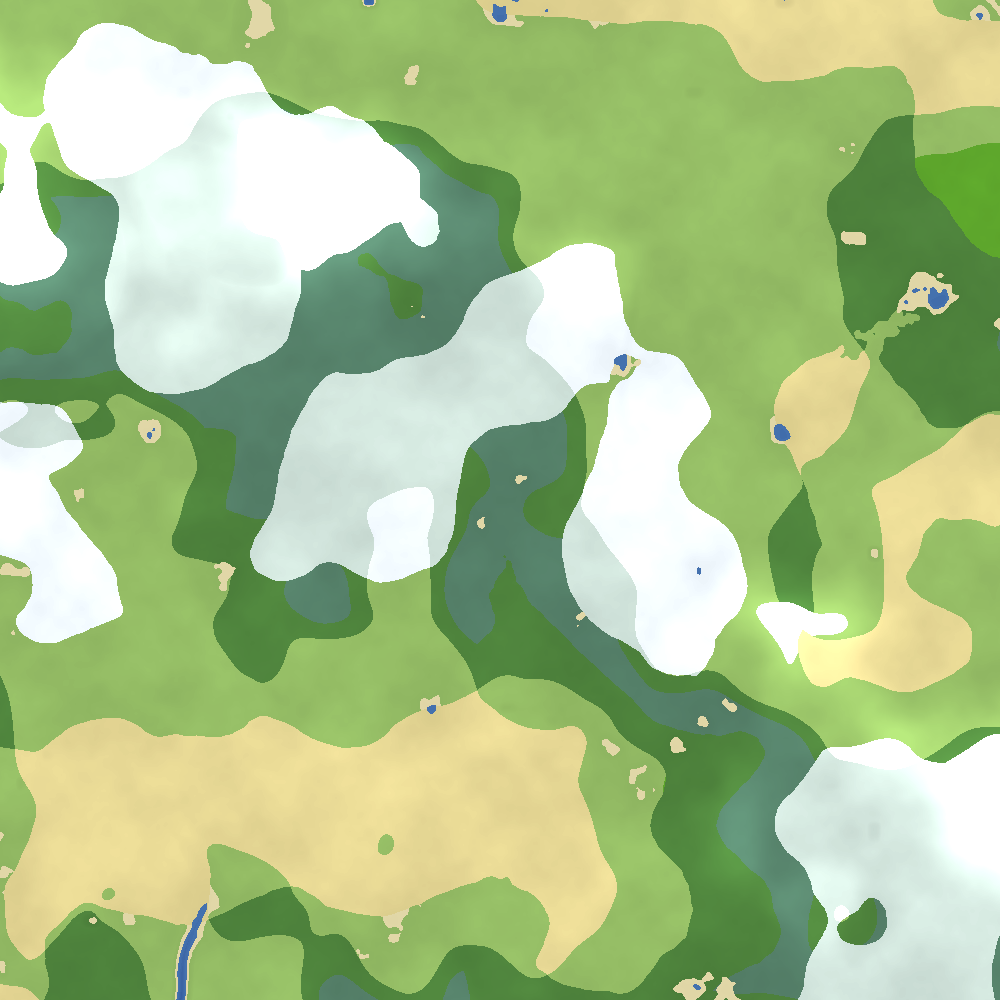

# World Forge — finite Minecraft Java worlds

Generates a **finite, bedrock-walled Minecraft Java Edition world** with simple
"1.12-style" rolling terrain, caves, ore veins, snowy mountains, and the common
land biomes — centered on `(0, 0)` and sealed inside a bedrock box.

It writes real region files (`.mca`) directly, so there's nothing to install
inside Minecraft — you just drop the folder into your `saves/`.

The web UI has two generators, switchable from the toggle in the header:

- **Vanilla** — the finite, bedrock-walled overworld described below.
- **Skywars** — procedural floating-island PvP maps in a void world (see
  [Skywars generator](#skywars-generator)).



---

## Quick start (web UI)

**Windows (easiest):** double-click **`setup.bat`** once (creates an isolated
environment and installs the dependencies), then double-click **`start.bat`** to
launch the server — it opens **http://127.0.0.1:5000** in your default browser
automatically. After the first time you only need `start.bat`.

```bash
# macOS / Linux
./run.sh
# Windows (alternative to the .bat files above)
run.bat
```

Then open **http://127.0.0.1:5000**, adjust settings, click **Forge world**, and
download the `.zip` when the map appears.

To install the world: unzip it into your Minecraft saves folder, then pick it
from the singleplayer world list.

| OS      | saves folder |
|---------|--------------|
| Windows | `%APPDATA%\.minecraft\saves` |
| macOS   | `~/Library/Application Support/minecraft/saves` |
| Linux   | `~/.minecraft/saves` |

## Quick start (command line)

```bash
pip install -r requirements.txt
python cli.py --name "Valley" --size 1000 --seed 42 --out ./Valley
python cli.py --size 1000 --workers 8 --out ./ValleyFast
python cli.py --size 512 --workers 16 --out ./TinyCrunch   # uses tiled jobs when useful
# then copy ./Valley into your saves folder
python cli.py --help      # all options
```

---

## What you can control

- **Boundaries** — square overworld, any size (default **1000×1000**), always
  centered on `0,0` and growing outward evenly. Optional Nether generation adds
  a separate **1000×1000** bedrock box 500 blocks to the right.
- **Vertical shape** — bedrock **floor Y** (default **−20**, void below it),
  water level, and base land height.
- **Bedrock border wall** — encases the whole border. By default it runs from the
  world bottom (**−64**) to the world top (**319**) with **no ceiling**. Both ends
  are configurable.
- **Ore veins** — a table of ores, each with its own Y range, veins-per-chunk
  rate, vein size, and a **depth bias** (cluster low / mid / high). Defaults ship
  the full vanilla-flavoured set — **coal, iron, copper, gold, redstone, lapis,
  and diamond** — placed at vanilla-like depths (diamond, redstone
  and gold skew deep; lapis is rarest).
- **Terrain & mountains** — hill height, mountain amount/height, and the snow line
  (snowy caps get a top snow layer).
- **Biomes** — plains, forest, birch forest, dark oak forest, **desert**,
  badlands/mesa, taiga, jungle, snowy plains, snowy taiga, snowy mountain
  slopes, beaches, and river, chosen by blended temperature/humidity so zones
  transition naturally. Auto-balancing keeps individual seeds from becoming all
  snow, all forest, or all plains. **No oceans**; gentle rivers and small ponds
  only.
- **Natural water** — winding rivers and small lakes with **soft, gradual banks**
  (no cliff-walled trenches), **sand/gravel beaches**, and **clay & gravel beds**.
- **Underground variety** — **diorite / granite / andesite** pockets, dirt &
  gravel blobs, a bottom **lava aquifer**, dense branching caves, and **ravines
  that open from the surface** down to the depths.
- **Surface decoration** — scattered grass & tall grass, biome flowers, **sugar
  cane** by water, **cactus / dead bushes** in arid biomes, and larger 2×2
  jungle trees with fanned-out leaf crowns.
- **Caves, ravines, rivers, lakes, trees, decoration, stone variants** — toggle
  and tune each.
- **Target version** — 1.20.1 → 1.21.7 (worlds also open in newer versions).

Every setting is reproducible: the same **seed + settings** always rebuilds the
exact same world.

---

## Skywars generator

Pick **Skywars** in the header toggle to build floating-island PvP maps in a
pure **void** world instead. Each **cluster** is one big central island (with
**ender chests** scattered on top), a ring of medium "middle" islands around it,
and an outer ring of **spawn islands** (regular chests). Islands are **flat on
top** for PvP and taper to a spiky underside, carry **varied biomes /
temperatures**, occasional **trees, rocks and light foliage**, and **ores both
on the surface and buried in the stone**.

- **Map size** — the number of spawn islands per cluster (default **12**, scales
  up past **64**). The middle-ring count derives from it.
- **Batches** — generate many clusters into one world at once (e.g. *10 clusters
  of 24 spawn islands + 10 of 12 + 10 of 32*). Clusters are placed on a padded
  grid, always **≥200 blocks apart**.
- **Ores** — a table of ores each with a configurable **ratio** (relative
  frequency), plus overall density and surface-exposure sliders.
- **Islands** — main / middle / spawn radii, ring gap, base height and per-island
  height variation, and the middle-ring amount.
- **Chests** — counts per spawn island, per middle island, and ender chests on
  the central island.

Every cluster writes its own labelled **positions JSON** (a spawn point for each
spawn island plus the central island's midpoint) into a `positions/` folder, and
the download bundles the world **and** those JSONs in one `.zip`:

```
Skywars.zip
├── Skywars/                 ← the world save (level.dat, region/*.mca)
└── positions/
    ├── cluster_00_24islands.json
    ├── cluster_01_12islands.json
    └── positions.json       ← combined index of every cluster
```

`skywars_generator.py` is self-contained (it only shares `region.py` / `nbt.py`)
so it never touches the vanilla `generator.py`.

---

## How it works (and why it's built this way)

Minecraft's own world generation (via world presets or data packs) is
*infinite* by design — there's no built-in way to make a finite world ringed in
real bedrock, and a `/fill` bedrock box would be millions of commands. So World
Forge generates the terrain itself and writes it straight into the Anvil region
format:

- `noise.py` — seeded, vectorized value noise (no external noise lib).
- `generator.py` — terrain height, biome/climate assignment, cave carving, ore
  veins, trees, snow, the bedrock floor, the border wall, optional separate
  Nether box, region-level multiprocessing, and tiled jobs for small worlds or
  manually high worker counts.
- `region.py` — assembles 1.18+ chunk NBT (palette-based `block_states` /
  `biomes`, negative-Y sections) and packs region files.
- `nbt.py` — a small NBT binary writer.
- `app.py` / `templates/index.html` — the web UI.
- `cli.py` — headless generation.
- `verify.py` — self-check that re-parses the output (`python verify.py <world>`).

The world's stored generator is set to **flat void**, so anything beyond the
bedrock walls is empty space rather than stray vanilla terrain. You're sealed
inside the box regardless.

Terrain uses the plain `stone` / `diamond_ore` palette everywhere (even below
`y=0`) for that older, simpler look, instead of deepslate.

---

## Notes & limitations

- Generation uses multiple worker processes by default. Auto mode uses your CPU
  thread count; use `--workers 1` for fully serial generation or `--workers N`
  to manually push harder. Region jobs write `.mca` files directly from workers;
  when there are fewer region jobs than requested workers, the generator switches
  to smaller tiled jobs so extra cores can still do useful work.
- The web preview updates while generation is running. Its colours are quantized
  to a Minecraft map-style palette rather than the older smooth biome preview.
- A **1000×1000** world produces about **15–20 MB** of region files; generation
  time depends heavily on worker count and CPU.
- Lighting and heightmaps are recomputed by Minecraft on first load, so the very
  first time you open the world near the edges it may relight briefly.
- Trees are clipped at chunk borders in rare cases (cosmetic).
- The End is left to vanilla defaults. When enabled, the Nether content is forged
  into the separate overworld-region box rather than generated as a datapack or a
  vertical layer.
- Requires Python 3.9+.
